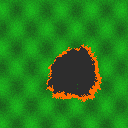

# Parallel Wildfire Propagation Simulation (Cellular Automata + OpenMP, C)

A 2D wildfire cellular automaton in **C11 + OpenMP**. Each cell is `UNBURNT`, `BURNING` or
`BURNED`. Ignition depends on **fuel**, **wind** and **terrain slope**. The project studies
correctness, scheduling, SIMD/memory optimisation and scaling of the OpenMP stencil.


## 1. Build

Linux or WSL2 (recommended), gcc >= 9.  macOS: `brew install gcc` then `make CC=gcc-14`.

```bash
make            # ./wildfire         (optimised, SIMD on)
make novec      # ./wildfire_novec   (vectorisation OFF, for the SIMD comparison)
make vecreport  # which loops the compiler vectorised
pip install pandas matplotlib pillow     # for plots / images
```

## 2. Try it (also your demo script)

```bash
./wildfire --n 64 --m 64 --steps 20 --kernel opt --threads 4 --terrain hilly --seed 42 --verify --ascii                 # picture in the terminal
./wildfire --n 512 --steps 300 --kernel opt --threads 4 --verify      # PASS = identical to serial
./wildfire --n 400 --steps 240 --ignitions 3 --out fire.ppm --snap-every 80 && python3 viz.py fire_t00*.ppm fire.ppm --montage fire.png
```

`--verify` runs the serial reference next to the parallel run and compares the whole grid
(FNV-1a checksum) **at every step**. Never use `--verify` for timing runs.

### Kernels
| `--kernel` | what it is | chunk size means |
|---|---|---|
| `serial` | reference, no OpenMP pragmas (the baseline for speedup) | - |
| `base`   | `parallel for collapse(2) schedule(runtime)` | cells |
| `opt`    | row-parallel + `restrict` + SIMD pre-pass that flags cells next to fire | rows |

All three give **bit-identical** results for any thread count (counter-based RNG
`hash_rand(seed,i,j,t)`, pull-style update, `-ffp-contract=off`).

### All options
`./wildfire --help`  (grid size `--n/--m`, `--steps`, `--threads`, `--sched static|dynamic|guided`,
`--chunk`, `--terrain flat|hilly`, `--ignitions`, `--wind-speed`, `--wind-angle`, `--p0`, `--cs`,
`--burn-time`, `--seed`, `--out`, `--snap-every`, `--ascii`, `--tag`, `--quiet`).

Output: **one CSV line on stdout**, human summary on stderr.
Columns: `kernel,terrain,n,m,steps,threads,schedule,chunk,seed,ignitions,time_s,mcups,imbalance,burned_frac,checksum,verify,tag`

* `mcups` = million cell updates per second = (n-2)(m-2)*steps / time / 1e6
* `imbalance` = max thread busy time / mean thread busy time (1.0 = perfect balance)
* Only the time-stepping kernel is timed (not setup, verification or image writing).

## 3. Who does what

| | **Srikripa** | **Kumud** | **Gautami** |
|---|---|---|---|
| Day-1 file | `src/sim.c` (engine, base kernel) | `src/init.c` (terrain, wind, ignition, images) | `src/main.c` (driver, checksum, CSV) |
| OpenMP question | Is it correct and race-free? | Which schedule balances load best? | What do SIMD/memory layout give, and how does it scale? |
| Scripts | `verify.sh`, `strong_scaling.sh` | `sweep_schedule.sh`, `bind_study.sh` | `simd_compare.sh`, `weak_scaling.sh`, `plot_results.py` |

Everyone: report, slides, paper, demo.

## 4. Experiments (Day 3)  -- run on ONE machine, nothing else running

```bash
export THREADS="1 2 4 8 16"      # use your PHYSICAL core count (nproc counts hyper-threads!)
export STEPS=200 REPEATS=3
./scripts/verify.sh                       # Srikripa: must print "ALL CORRECT"
./scripts/strong_scaling.sh               # Srikripa -> results/strong.csv   (SIZES="1024 2048 4096")
./scripts/sweep_schedule.sh               # Kumud    -> results/schedule.csv
./scripts/bind_study.sh                   # Kumud    -> results/bind.csv
./scripts/simd_compare.sh                 # Gautami  -> results/simd.csv     (needs `make novec`)
./scripts/weak_scaling.sh                 # Gautami  -> results/weak.csv     (BASE_N=1024, N=BASE_N*sqrt(p))
python3 plot_results.py                   # figures -> figs/, tables printed + results/*_summary.csv
```

Runtime guide: 1024^2 for 200 steps takes ~1 s serial and 4096^2 about 20 s (16x more cells); the full sweep
can take an hour or more, so reduce `SIZES` / `STEPS` / `REPEATS` if you are short on time. Start with `SIZES="1024 2048"`.

Definitions used in the plots: `Speedup vs serial = T_serial / T_parallel. Speedup vs the same kernel's 1-thread run = T_1-thread / T_p-thread. Parallel efficiency = (speedup vs the same kernel's 1-thread run / number of threads) × 100%.`, `efficiency = speedup / threads`,
`weak efficiency = T(1 thread, base size) / T(p threads, scaled size)`; medians over the repeats.

## 5. Tips and pitfalls

* **Report only numbers your own machine produced.** Quote the CPU model, core count, compiler and flags
  (`lscpu`, `gcc --version`) in the Experimental Setup section.
* A stencil is **memory-bandwidth bound**: speedup flattening at 4-8 threads is normal. Explain it, don't hide it.
* Close browsers etc. while benchmarking; plug in the laptop; disable power-saving.
* libgomp's built-in default for `schedule(runtime)` is `dynamic,1`; this program forces `static` unless
  you pass `--sched` or set `OMP_SCHEDULE`, so "default" results are really static.
* `opt` differs from `base` in several ways (row-wise loop, restrict, SIMD pre-pass). To isolate SIMD, compare
  `opt-novec` vs `opt-simd` (the `simd_compare.sh` output), not `base` vs `opt`.
* The terrain is synthetic (sine waves + Gaussian hill) and the model parameters are illustrative, not
  calibrated against a real fire. Say so in the paper's limitations.

## 6. Layout

```
src/wildfire.h  shared structs, RNG          scripts/   verify, scaling, schedule, binding, SIMD
src/sim.c       serial / base / opt kernels  plot_results.py  CSV -> figures + tables
src/init.c      terrain, wind, ignition, PPM viz.py     PPM -> PNG
src/main.c      CLI, timing, checksum, CSV   results/ figs/   outputs (git-ignored data, keep the folders)
```


## Sample Output

The wildfire simulation output is shown below.



## Limitations

- The terrain and wildfire parameters are synthetic and are not calibrated against real wildfire data.
- Performance measurements depend on the hardware, compiler, and runtime environment.
- Results may vary with thread count, scheduling policy, and workload size.
- The simulation is intended for studying parallel computing and wildfire propagation, not for predicting real-world fires.

